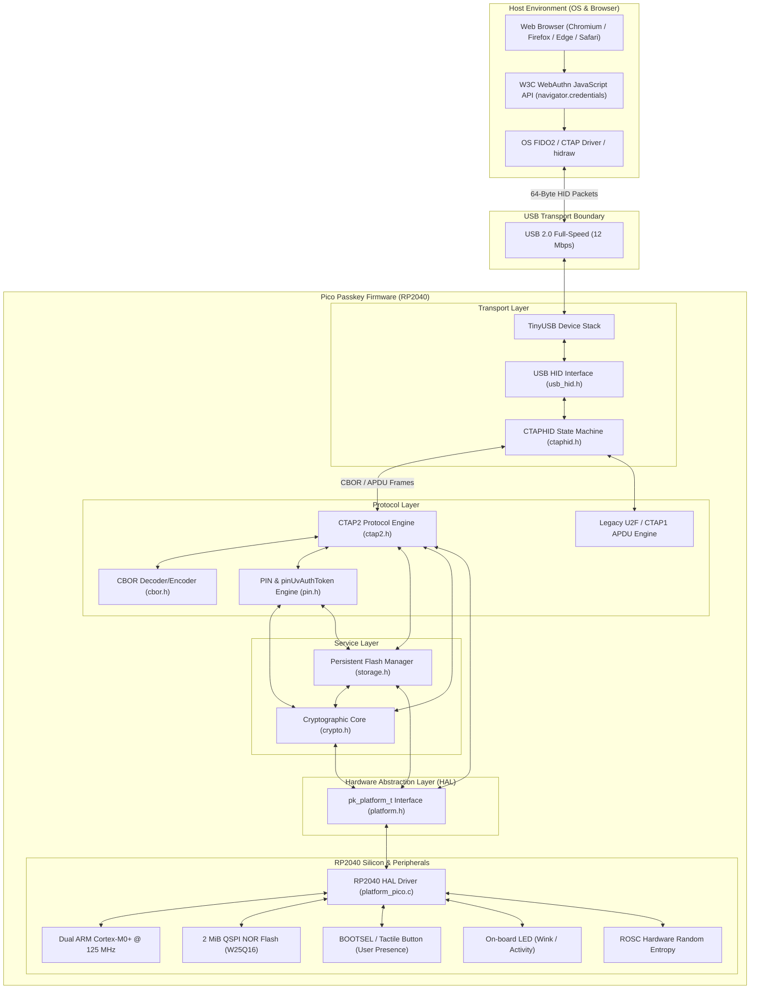
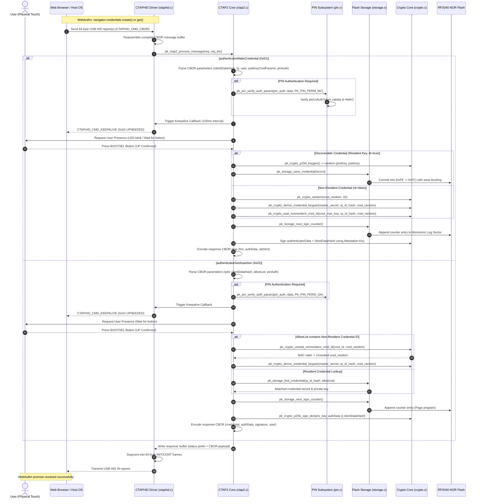

# Architecture Specification: Pico Passkey

This document details the software architecture, protocol layering, cryptographic engines, flash storage layout, wear-leveling algorithms, and module interface specifications for the **Pico Passkey** FIDO2 / WebAuthn authenticator firmware running on the Raspberry Pi Pico (RP2040).

---

## 1. System Architecture & Layering

Pico Passkey implements the complete FIDO Alliance Client-to-Authenticator Protocol (CTAP v2.1) and Universal 2nd Factor (CTAP1 / U2F) specifications. The architecture follows a strict decoupled, layered model where protocol logic is 100% independent of physical microcontroller hardware, enabling deterministic native host unit testing.



---

## 2. CTAPHID Packet Reassembly State Machine

CTAPHID defines framing rules over 64-byte USB HID report packets. Commands larger than 57 bytes require segmentation across an Initial packet (`INIT`) and up to 128 Continuation packets (`CONT`), supporting payloads up to 7,609 bytes.

```mermaid
stateDiagram-v2
    [*] --> Idle

    state Idle {
        [*] --> AwaitPacket
        AwaitPacket --> CheckChannel: 64-byte packet received
        CheckChannel --> HandleInit: CID == 0xFFFFFFFF (Broadcast) && CMD == CTAPHID_CMD_INIT
        CheckChannel --> RouteActive: CID matches active or assigned channel
        CheckChannel --> ErrorMismatch: Unknown CID -> Return CTAPHID_ERR_INVALID_CHANNEL
    }

    state HandleInit {
        [*] --> AllocateChannel
        AllocateChannel --> SendInitResp: Assign new 32-bit CID
        SendInitResp --> Idle: Transmit 17-byte INIT response
    }

    state AssembleFrame {
        RouteActive --> CheckPacketType: Parse Packet Header
        CheckPacketType --> ProcessInitPacket: Bit 7 set (INIT Packet)
        CheckPacketType --> ProcessContPacket: Bit 7 clear (CONT Packet)

        state ProcessInitPacket {
            [*] --> ParseLen: CMD, BCNT (high/low byte)
            ParseLen --> SinglePacketComplete: BCNT <= 57 bytes
            ParseLen --> MultiPacketPending: BCNT > 57 bytes (expected_seq = 0)
        }

        state ProcessContPacket {
            [*] --> VerifySeq: Check packet seq == expected_seq
            VerifySeq --> Accumulate: seq matches -> append payload (up to 59 bytes)
            VerifySeq --> SeqError: seq mismatch -> Send CTAPHID_ERR_INVALID_SEQ
            Accumulate --> CheckComplete: received_len >= total_len
            Accumulate --> MultiPacketPending: received_len < total_len (expected_seq++)
        }
    }

    MultiPacketPending --> TimeoutCheck: 500ms Transaction Timer
    TimeoutCheck --> SendTimeoutError: Elapsed > 500ms -> Send CTAPHID_ERR_TIMEOUT
    SendTimeoutError --> Idle

    MultiPacketPending --> HandleCancel: Received CTAPHID_CMD_CANCEL
    HandleCancel --> Idle: Abort transaction

    SinglePacketComplete --> DispatchCommand
    CheckComplete --> DispatchCommand

    state DispatchCommand {
        [*] --> Execute
        Execute --> RouteCBOR: CMD == CTAPHID_CMD_CBOR (0x90) -> pk_ctap2_process_message
        Execute --> RouteMSG: CMD == CTAPHID_CMD_MSG (0x83) -> pk_ctap1_process_apdu
        Execute --> RoutePing: CMD == CTAPHID_CMD_PING (0x81) -> Echo payload
        Execute --> RouteWink: CMD == CTAPHID_CMD_WINK (0x88) -> pk_platform_wink
        Execute --> RouteLock: CMD == CTAPHID_CMD_LOCK (0x84) -> Set locked_cid
    }

    DispatchCommand --> SendResponse: Command execution finished
    SendResponse --> FragmentResponse: Fragment payload into 64-byte packets
    FragmentResponse --> Idle: Transmit INIT + CONT frames via USB IN endpoint
```

### Protocol Rules & Timeouts
1. **Transaction Timeout (`PK_CTAPHID_TRANS_TIMEOUT_MS` = 500 ms)**: If consecutive packets of a multi-packet transaction are not received within 500 ms, the reassembly buffer is dropped and `CTAPHID_ERR_TIMEOUT` is returned.
2. **Channel Arbitration**: If a channel attempts to send an `INIT` packet while another channel has an incomplete transaction in progress, the authenticator responds with `CTAPHID_ERR_CHANNEL_BUSY`.
3. **Keepalive Packets (`CTAPHID_CMD_KEEPALIVE`)**: While awaiting physical user presence (`pk_platform_request_user_presence`), keepalive packets are transmitted every 100 ms with status `0x02` (`CTAPHID_STATUS_UPNEEDED`) or `0x01` (`CTAPHID_STATUS_PROCESSING`) to prevent host-side USB timeout.

---

## 3. MakeCredential & GetAssertion Sequence Flow

The following sequence illustrates the complete end-to-end flow from WebAuthn JavaScript invocation down to the physical flash and cryptographic core:



---

## 4. Flash Memory Map, Journaling & Wear-Leveling

The RP2040 utilizes an external 2 MiB QSPI NOR Flash (Winbond W25Q16 or equivalent). Flash memory properties:
- **Erase Granularity**: 4,096-byte (4 KiB) sectors (bits transition `0 -> 1`).
- **Program Granularity**: 256-byte pages (bits transition `1 -> 0`).
- **Endurance**: Typically 100,000 erase cycles per sector.

Pico Passkey reserves the **top 128 KiB** (32 sectors) of the 2 MiB space, from offset `0x1E0000` (`2,097,152 - 131,072`) to `0x200000`. The remaining 1,920 KiB is dedicated to application code and boot stages.

```
RP2040 2 MiB Flash Space
0x000000 +-------------------------------------------------------+
         | Firmware Code, Boot Stages, TinyUSB & mbedTLS         |
         | (1,920 KiB available for firmware binaries)           |
0x1E0000 +-------------------------------------------------------+
         | PICO-PASSKEY RESERVED STORAGE REGION (128 KiB)        |
         |                                                       |
Sector 0 |   Sector 0 (4 KiB): State Sector A (Journaled)       |
Sector 1 |   Sector 1 (4 KiB): State Sector B (Journaled)       |
Sector 2 |   Sector 2 (4 KiB): Monotonic Counter Log Sector A   |
Sector 3 |   Sector 3 (4 KiB): Monotonic Counter Log Sector B   |
Sector 4 |   Sector 4 (4 KiB): Resident Credential Sector 0     |
         |   ...                                                 |
Sector 31|   Sector 31 (4 KiB): Resident Credential Sector 27    |
0x200000 +-------------------------------------------------------+
```

### 4.1 A/B Journaled State Sectors (Sectors 0 & 1)
Device root secrets, PIN configuration, retry counters, and attestation seeds are persisted using an atomic dual-sector ping-pong log:
- **Magic**: `0x32534B50` (`"PKS2"`)
- **Structure**:
  ```c
  typedef struct {
      uint32_t magic;           /* PK_STORAGE_STATE_MAGIC */
      uint32_t version;         /* PK_STORAGE_VERSION (1) */
      uint32_t generation;      /* Monotonically incremented generation */
      pk_device_state_t state;  /* Keys, PIN salt, verifier, retry counts */
      uint32_t crc32;           /* IEEE 802.3 CRC32 of above fields */
  } pk_state_sector_header_t;
  ```
- **Crash Consistency**: When writing new state, the inactive sector is erased, programmed with `generation = active_generation + 1`, and verified against CRC32. The active sector pointer switches only after the write succeeds. If power is interrupted mid-write, the previous valid sector retains full state integrity.

### 4.2 Append-Only Monotonic Counter Log (Sectors 2 & 3)
FIDO2 requires a global signature counter (`signCount`) incremented on every assertion to detect cloned authenticators. Erasing a 4 KiB flash sector on every login would destroy flash endurance in under 100,000 sign-ins.
- Pico Passkey uses an **append-only page log**:
  - Each 4 KiB sector contains 16 pages of 256 bytes.
  - Page 0 contains the sector base counter.
  - Subsequent 8-byte entries (`delta`, `checksum`) are written into unprogrammed flash bytes without erasing the sector.
  - When Sector A is filled (thousands of assertions), the current counter value is snapshotted into persistent state, Sector B is erased and activated, achieving over 500,000 assertions before any single sector erase.

### 4.3 Wear-Leveled Resident Credential Pool (Sectors 4..31)
- **Sector Count**: 28 sectors (112 KiB).
- **Slot Capacity**: 4 slots of 1,024 bytes per 4 KiB sector = **112 total slots**.
- **Max Active Credentials**: Capped at **64 active credentials** (`PK_STORAGE_MAX_RESIDENT_CREDS`), ensuring a minimum of 48 free slots (43% free headroom) for wear leveling and background compaction.
- **Slot Lifecycle States (Bitwise 1 -> 0 Transitions)**:
  ```
  Empty (0xFF)  --->  Committing (0xFE)  --->  Active (0xFC)  --->  Tombstone (0x00)
  [All 1s erased]     [Header written]        [Record verified]    [Invalidated/Deleted]
  ```
- **Atomicity on Replace**: Updating a resident credential for an existing `(rp_id_hash, user_id)` writes the new record to an empty slot in `Committing` status, marks it `Active`, and only then marks the prior slot as `Tombstone` (0x00).
- **Wear Leveling**: The allocator tracks an erase counter (`erase_count`) per sector. When allocating a new slot, sectors with the lowest erase counts are prioritized. Compaction (garbage collection) erases only sectors consisting exclusively of tombstones or copies valid records into the lowest-erase candidate sector.

---

## 5. Module Interface Specifications

| Header | Primary Responsibilities | Key Types & Constants | Core Functions |
|---|---|---|---|
| [`platform.h`](../include/passkey/platform.h) | Hardware abstraction layer (HAL) isolating hardware from protocol logic | `pk_platform_t`, `pk_up_result_t`, `pk_keepalive_cb_t` | `now_ms`, `get_random_bytes`, `get_unique_id`, `flash_read`, `flash_erase_sector`, `flash_program_page`, `request_user_presence`, `wink` |
| [`crypto.h`](../include/passkey/crypto.h) | Cryptographic primitives (P-256 ECDSA/ECDH, SHA-256, HMAC, HKDF, AES-256-CBC, non-resident credential seal/unseal) | `pk_crypto_ctx_t`, `pk_p256_pubkey_t`, `PK_COSE_ALG_ES256`, `PK_COSE_ALG_ECDH_ES_HKDF_256` | `pk_crypto_init`, `pk_crypto_zeroize`, `pk_crypto_consttime_eq`, `pk_crypto_p256_keygen`, `pk_crypto_derive_credential_keypair`, `pk_crypto_p256_sign_der`, `pk_crypto_seal_nonresident_cred_id` |
| [`cbor.h`](../include/passkey/cbor.h) | Zero-allocation streaming CBOR parser & canonical encoder | `pk_cbor_reader_t`, `pk_cbor_writer_t`, RFC 8949 major types | `pk_cbor_encode_*`, `pk_cbor_decode_*`, `pk_cbor_encode_cose_p256_pubkey`, `pk_cbor_decode_cose_p256_pubkey` |
| [`storage.h`](../include/passkey/storage.h) | A/B state journaling, monotonic counter logging, and wear-leveled resident credential storage | `pk_storage_ctx_t`, `pk_device_state_t`, `pk_resident_cred_t` | `pk_storage_init`, `pk_storage_factory_reset`, `pk_storage_save_state`, `pk_storage_next_sign_counter`, `pk_storage_save_credential`, `pk_storage_find_credential` |
| [`pin.h`](../include/passkey/pin.h) | CTAP2 `authenticatorClientPIN` protocol v1, retry decrementing, and ephemeral `pinUvAuthToken` permissions | `pk_pin_ctx_t`, `PK_PIN_PERM_*`, `PK_PIN_SUBCMD_*` | `pk_pin_init`, `pk_pin_handle_command`, `pk_pin_verify_auth_param`, `pk_pin_validate_policy`, `pk_pin_get_retries`, `pk_pin_is_boot_blocked` |
| [`ctap2.h`](../include/passkey/ctap2.h) | Top-level CTAP2 command dispatcher (`MakeCredential`, `GetAssertion`, `GetInfo`, `Reset`) & CTAP1 U2F APDU processor | `pk_ctap2_ctx_t`, `pk_assertion_session_t` | `pk_ctap2_init`, `pk_ctap2_process_message`, `pk_ctap1_process_apdu`, `pk_ctap2_set_keepalive_callback` |
| [`ctaphid.h`](../include/passkey/ctaphid.h) | CTAPHID transport framing, channel allocation, packet reassembly/fragmentation, lock, ping, and cancel | `pk_ctaphid_ctx_t`, `pk_ctaphid_channel_t`, `pk_ctaphid_rx_state_t` | `pk_ctaphid_init`, `pk_ctaphid_rx_packet`, `pk_ctaphid_check_timeouts`, `pk_ctaphid_send_response`, `pk_ctaphid_send_error` |
| [`usb_hid.h`](../include/passkey/usb_hid.h) | USB HID device descriptor, report transmission queue, and TinyUSB endpoint hooks | `pk_usb_state_t`, `pk_fido_hid_report_desc` | `pk_usb_init`, `pk_usb_task`, `pk_usb_get_state`, `pk_usb_queue_tx_packet` |
