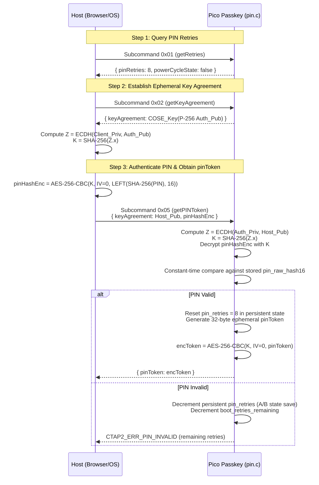

# FIDO2 & CTAP Capabilities Specification: Pico Passkey

This document details the standards compliance, protocol commands, cryptographic algorithms, authenticator options, extensions, and credential storage architectures implemented in **Pico Passkey**.

---

## 1. Standards Compliance & Identification

| Property | Value / Specification |
|---|---|
| **FIDO Specifications** | FIDO CTAP v2.1, FIDO CTAP v2.0, FIDO U2F v1.2 (CTAP1) |
| **W3C Specifications** | Web Authentication (WebAuthn) Level 1, Level 2, and Level 3 Candidate |
| **Authenticator AAGUID** | `f1d02040-7069-636f-8000-706173736b65` |
| **USB Vendor ID (VID)** | `0x2E8A` (Raspberry Pi Foundation) |
| **USB Product ID (PID)** | `0xF1D0` (Pico Passkey FIDO2 Security Key) |
| **USB Device Class** | USB Human Interface Device (HID) — Class `0x03`, Subclass `0x00`, Protocol `0x00` |
| **FIDO HID Report Descriptor** | Official 34-byte FIDO Alliance Report Descriptor (Usage Page `0xF1D0`, Usage `0x01`) |
| **Transports** | USB (`"usb"`) |

---

## 2. Supported Protocol Commands

### 2.1 CTAP2 Commands (over `CTAPHID_CMD_CBOR` = `0x90`)

| Code | Command Name | Description | Status / Notes |
|---|---|---|---|
| `0x01` | `authenticatorMakeCredential` | Generates a new credential for a Relying Party (RP). Supports both resident (discoverable) and non-resident credentials. | Fully Supported |
| `0x02` | `authenticatorGetAssertion` | Generates an authentication signature for an existing credential. Authenticates user presence and optional client PIN. | Fully Supported |
| `0x04` | `authenticatorGetInfo` | Returns authenticator capabilities, supported versions, extensions, options, AAGUID, and pinProtocols. | Fully Supported |
| `0x06` | `authenticatorClientPIN` | Manages client PIN, key agreement, PIN change, and issuing `pinUvAuthToken`. Implements PIN Protocol v1. | Fully Supported |
| `0x07` | `authenticatorReset` | Performs factory reset: generates new master secrets, wipes all credentials, resets PIN. Enforces 10-second boot window. | Fully Supported |
| `0x08` | `authenticatorGetNextAssertion` | Fetches subsequent assertions when multiple resident credentials match a requested RP ID. | Fully Supported |

### 2.2 CTAP1 / U2F Commands (over `CTAPHID_CMD_MSG` = `0x83`)

For backward compatibility with legacy U2F clients and services:
| INS Code | Command Name | Description |
|---|---|---|
| `0x01` | `U2F_REGISTER` | Registers a U2F credential, returns user public key, credential handle, and attestation certificate. |
| `0x02` | `U2F_AUTHENTICATE` | Verifies user presence, checks credential handle, increments monotonic counter, and returns ECDSA signature. |
| `0x03` | `U2F_VERSION` | Returns the UTF-8 version string `"U2F_V2"`. |

### 2.3 CTAPHID Low-Level Commands

| Code | Command | Description |
|---|---|---|
| `0x86` | `CTAPHID_CMD_INIT` | Synchronizes channel ID (`CID`) allocation and returns protocol versions and capabilities. |
| `0x81` | `CTAPHID_CMD_PING` | Echoes back up to 7,609 bytes of arbitrary diagnostic payload. |
| `0x84` | `CTAPHID_CMD_LOCK` | Locks the authenticator to a specific CID for up to 10 seconds. |
| `0x88` | `CTAPHID_CMD_WINK` | Flashes the on-board LED in a distinctive pattern for device location identification. |
| `0x91` | `CTAPHID_CMD_CANCEL` | Host-initiated abort of an in-progress operation (e.g. while awaiting user presence). |
| `0xBB` | `CTAPHID_CMD_KEEPALIVE` | Authenticator-to-host periodic frame (every 100 ms) notifying UP wait state (`0x02`) or processing (`0x01`). |
| `0xBF` | `CTAPHID_CMD_ERROR` | Error notification frame on framing, sequence, channel, or timeout faults. |

---

## 3. Cryptographic Algorithms (COSE)

Pico Passkey registers and processes the following standard COSE algorithms:

### 3.1 COSE Algorithm `-7`: `ES256` (ECDSA w/ SHA-256 over NIST P-256)
- **Key Type (`kty`)**: `2` (`EC2`)
- **Curve (`crv`)**: `1` (`P-256` / `secp256r1`)
- **Public Key Representation**: Canonical CBOR map:
  ```cbor
  {
      1: 2,           // kty: EC2
      3: -7,          // alg: ES256
     -1: 1,           // crv: P-256
     -2: h'xxxxxxxx', // x-coordinate (32 bytes)
     -3: h'yyyyyyyy'  // y-coordinate (32 bytes)
  }
  ```
- **Signature Output**: Strict ASN.1 DER-encoded `ECDSA-Sig-Value`:
  ```
  SEQUENCE {
      r INTEGER,
      s INTEGER
  }
  ```
  Normalized with low-$S$ per RFC 6979 and WebAuthn specifications (length between 70 and 72 bytes).

### 3.2 COSE Algorithm `-25`: `ECDH-ES + HKDF-256`
- Used exclusively during the CTAP2 `authenticatorClientPIN` protocol to establish an ephemeral shared symmetric key between the client (browser) and authenticator without exposing the PIN over the USB wire.
- **Key Agreement**: P-256 ECDH computing shared coordinate $Z_x$.
- **Key Derivation**: $K = \text{SHA-256}(Z_x)$.

---

## 4. Authenticator Options (`authenticatorGetInfo`)

When the browser or OS queries `authenticatorGetInfo`, Pico Passkey returns the following option flags:

| Option Key | Value | Semantic Meaning |
|---|---|---|
| `plat` | `false` | Cross-platform external authenticator (roaming security key via USB). |
| `rk` | `true` | **Resident Keys / Passkeys**: Fully supports storing discoverable resident credentials in flash memory. |
| `clientPin` | `true` / `false` | Indicates whether client PIN is configured (`true`) or not yet set (`false`). |
| `up` | `true` | **User Presence**: Requires physical confirmation (pressing the on-board BOOTSEL button) for operations. |
| `uv` | `false` | Built-in biometric user verification is not present (PIN is used for user verification). |
| `pinUvAuthToken`| `true` | Supports CTAP2.1 scoped permission tokens (`pinUvAuthToken`). |
| `credMgmt` | `true` | Supports FIDO2.1 Credential Management for enumerating and deleting resident credentials. |

---

## 5. Extensions Supported

### 5.1 `hmac-secret` (FIDO2 Extension)
The `hmac-secret` extension enables WebAuthn Pseudo-Random Function (PRF) capability.
- **Use Cases**: Offline file encryption (e.g. KeePassXC database unlocking), disk encryption token integration, and client-side credential encryption without exposing secrets to servers.
- **Operation**:
  - When requested during `MakeCredential`, the authenticator generates and associates an internal secret key with the credential.
  - During `GetAssertion`, the host supplies one or two 32-byte salts.
  - The authenticator computes `HMAC-SHA-256(cred_secret, salt)` and encrypts the output under the ephemeral PIN shared secret.

### 5.2 `credProtect` (Credential Protection Policy)
- Allows Relying Parties to enforce user verification (PIN) when storing credentials.
- Supported policy levels:
  - `userVerificationOptional` (`0x01`)
  - `userVerificationOptionalWithCredentialIdList` (`0x02`)
  - `userVerificationRequired` (`0x03`)

---

## 6. PIN Protocol v1 Specification

Pico Passkey implements FIDO CTAP2 PIN Protocol v1 (§6.5.4 & §6.5.5).



### 6.1 PIN Policy Validation (`pk_pin_validate_policy`)
- **Minimum Length**: 4 UTF-8 codepoints (and at least 4 bytes).
- **Maximum Length**: 63 bytes.
- **Prohibited Characters**: Embedded NUL (`0x00`) bytes are rejected.

### 6.2 Dual-Layer Retry Throttling
1. **Persistent Retry Counter (`pin_retries`)**:
   - Initialized to 8 attempts.
   - Persisted in A/B flash state **before** testing PIN candidate validity (prevents power-pull attacks).
   - Upon entering correct PIN: reset to 8.
   - Upon reaching 0: permanent authenticator lockout (`CTAP2_ERR_PIN_BLOCKED`). Can only be recovered by full factory reset (`authenticatorReset`).
2. **Per-Boot Retry Counter (`boot_retries_remaining`)**:
   - Initialized to 3 attempts in RAM on every boot cycle.
   - If 3 consecutive incorrect PIN attempts occur within a single boot session, PIN operations are rejected with `CTAP2_ERR_PIN_AUTH_BLOCKED` until the device is physically unplugged and replugged. This protects against fast automated brute-force attacks.

---

## 7. Credential Storage Architecture

Pico Passkey implements a hybrid architecture supporting both unlimited non-resident credentials and 64 high-speed resident credentials:

```mermaid
graph TD
    subgraph CredentialTypes["WebAuthn Credential Handling"]
        Req["MakeCredential Request"] --> CheckRK{"rk (Resident Key) requested?"}

        CheckRK -->|rk == false (Default)| NonResident["Non-Resident Sealed Credential"]
        CheckRK -->|rk == true (Passkey)| Resident["Resident Discoverable Credential"]

        subgraph NonResidentFlow["Non-Resident (Stateless / Sealed)"]
            NR1["Generate 32-byte random nonce: cred_random"]
            NR2["Derive private key: HKDF-SHA-256(master_secret, rp_id_hash, cred_random)"]
            NR3["Seal 64-byte Credential ID:<br/>cred_random (32B) || HMAC-SHA-256(cred_mac_key, rp_id_hash || cred_random)"]
            NR4["Flash Storage: ZERO flash bytes consumed (Unlimited credentials)"]
            NonResident --> NR1 --> NR2 --> NR3 --> NR4
        end

        subgraph ResidentFlow["Resident (Stateful / Discoverable)"]
            R1["Generate random SECP256R1 keypair"]
            R2["Allocate 1,024-byte slot in Sectors 4..31 (Wear-leveled)"]
            R3["Store metadata: rp_id, user_id, user_name, user_display_name, priv_key"]
            R4["Atomic bitwise commit (0xFF -> 0xFE -> 0xFC)"]
            R5["Flash Storage: Up to 64 resident credentials across 28 sectors"]
            Resident --> R1 --> R2 --> R3 --> R4 --> R5
        end
    end
```

### Detailed Comparison: Non-Resident vs. Resident

| Feature | Non-Resident Sealed Credential (`rk=false`) | Resident Discoverable Credential (`rk=true`) |
|---|---|---|
| **Flash Storage Usage** | **0 bytes** (Stateless on device) | 1,024 bytes per slot in Flash Sectors 4..31 |
| **Max Capacity** | **Unlimited** (Millions of websites) | **64 credentials** (`PK_STORAGE_MAX_RESIDENT_CREDS`) |
| **Credential ID Format** | 64 bytes: `cred_random` (32B) + HMAC-SHA-256 tag (32B) | 64 bytes: Random unique identifier |
| **Keypair Derivation** | Deterministic HKDF-SHA-256 from device `master_secret` | Randomly generated on SECP256R1 curve |
| **Relying Party Metadata** | Not stored on device; relying party provides `allowList` | Full `rp_id`, `user_id`, `user_name`, `display_name` |
| **User Experience** | Traditional 2FA / Passkey where site provides user handle | Full Passwordless / Discoverable ("Sign in with a passkey") |
| **Tamper Protection** | HMAC-SHA-256 sealed under `cred_mac_key` | Internal NOR flash storage + CRC32 verification |
